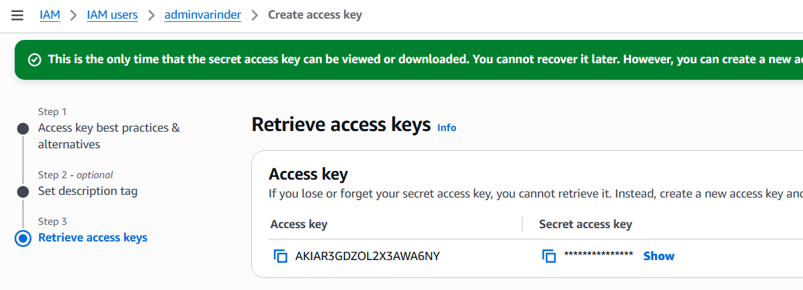
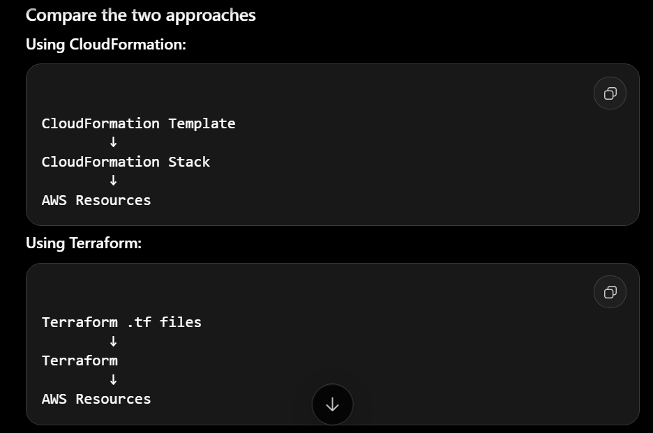

## Aws Login

1. Create IAM User using Root Account
2. Provide AdminPrevileges and create Access Key
   
3. aws configure

```
Azure	AWS	What it does
ARM Templates	CloudFormation	Native IaC
Bicep	CloudFormation	Easier way to write native IaC
Terraform	Terraform	Multi-cloud IaC

```


