## AI Assistant

A software application that understand your instructions and provide useful responses.

## Popular AI Assistants

- ChatGPT (By OpenAI)
- Gemini (By Google)
- Claude (By Anthropic)

## AI Assistants can do

- Answer your Question
- Write an Email
- Generate Program
- Translate language
- Summarize document
- Brainstorm Idea

## AI Assistant vs AI Agent

AI Assistant don't take decide or action on its own

## AI Agent

AI Agent is an AI Assistant with additional abilities:

1. Planning
2. Using Tools
3. Remembering Information
4. Taking actions on its own

## How does AI Assistant Answer Questions

1. You send a question/instruction to an AI Assistant through a progam (client application)
2. It receives your question/instruction
3. Send your question to LLM/AI Model
4. AI Model understand your question/instruction and generate the response
5. The response is send to your progam (client application)

## AI Model / LLM

- It is the brain of an AI assistant
- It has already learnt from enormous amount of books, articles, blogs, websites and publically available information
- When you ask a question, the model `predicts` the most appropriate answer based on this knowledge.
- Here we will use AI model, and do not train AI model

## Where does the AI Model runs

1. `Cloud Models`: The AI model runs on remote servers and your program sends request to them over the internet via API
   - Models from OpenAI, Google, Anthropic, Groq and others
2. `Local Models`: The AI model runs on your own machine.
   - Ollama (An Opensource AI Model)

### Advantage of Local Models

- Free (Opensource)
- Private (Installed on your machine)
- Great for learning

## What is an API

- API (Application Program Interface)
- Cloud Models are accessible via API, your program make call to these APIs with Questions/Instruction, these model understand the question and provide useful response.

## Setting up development environment

1. Python (Programming Language)
2. VS Code (IDEditor)
3. Ollama (AI Model)
4. GIT (Version Control System)

## Install Ollama

Ollama is a platform, that downloads and manage AI models for you.
There are many Opensource AI Model available. We will use

- Qwen3:4b

It provides a balance between speed and quality.

```
ollama pull qwen3:4b
```

```
ollama run qwen3:4b
>>> hello
```

```
Ctrl+C
```

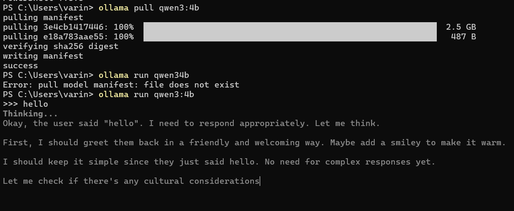

once the AI Model is downloaded, it need not to download again

## Create Project folder and virtual environment

The virtual environment keep libraries separate from other python project libraries on your computer.

1. Create virtual environment

   ```
   python -m venv .venv
   ```

2. Activate virtual environment

   `Windows`

   ```
   .venv/Scripts/activate
   ```

   `Linux`

   ```
   source .venv/bin/activate
   ```

3. Validate

   ```
   (.venv)
   ```

## First AI Program

1. Create environment file

   `.env`

   ```
    ## Ollama - qwen3:4b
    BASE_URL=http//localhost:11434/v1
    API_KEY=ollama
    MODEL=qwen3:4b
   ```

2. Create `hello.py`

   ```
    from openai import OpenAI
    from dotenv import load_dotenv
    import os

    load_dotenv()

    client = OpenAI(
        base_url=os.getenv("BASE_URL"),
        api_key=os.getenv("API_KEY")
    )

    message = [
        {
            "role":"user",
            "content":"What is Artificial Intelligence?"
        }
    ]

    response = client.chat.completions.create(
        os.getenv("MODEL"),
        message)

    print(response.choices[0].message.content)

   ```

3. Install dependencies

   ```
   pip install openai
   pip install dotenv
   ```

4. Run

   ```
   python hello.py
   ```

## Experiment Time

If you rerun the program with same prompt, everytime you get a different answer.

So it is generating the answer on every run.

You application becomes a bridge between the User and the AI Model

AI-Powered Application : Application with AI

## Build your first assistant

`Take input from console`

```
question = input("Enter your question")
```

## Conversational Loop

```
while (True) :
    question = input("Enter Question")

    message = [
        {
            "role":"user",
            "content":question
        }
    ]

    if (question.lower() == "quit") :
        print("Good Bye..")
        break

    response = client.chat.completions.create(
        model=os.getenv("MODEL"),
        messages=message
    )

    print(response.choices[0].message.content)
```

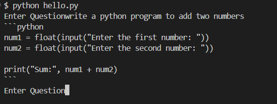

## AI Model Limitation

AI Model has no memory of your previous messages.

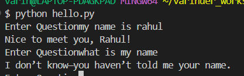

## Prompt

A Simple instruction we give to the AI Model

## Conversation loop

Instead of asking one hardcorded question, our assistant repeatedly

- wait for user input
- send it to the AI Model
- Dispaly the response
- Wait for the next question

Leads to an interactive conversation.

## AI Assistant with memory

`Problem Statement`

AI Assistant donot remember the previous conversation

`Solution`

Pass entire conversation to LLM everytime

- Question 1
- Answer 1
- Question 2
- Answer 2
- ..
- ..

If we pass entire `conversation history`, our AI Assistant becomes smarter because it understand the `context`.

## How conversation memory works

Using List

#### index start from 0

```
messages = [
    {
        "role"="user",
        "content"=question
    },
    {
        "role"="assistant",
        "content"=Answer
    }
]
```

So everytime someone speaks we add another message into the list. The will give the Assistant `memory`, and it understand the context.

## Store conversation history using python list

1. Create empty list

   ```
   messages = List[]
   ```

2. `Append` User Message and Assistant Message `Object` into the List
   - Message `Object` has
     - (`role`) who is speaking
       - user
       - assistant
       - system
     - (`content`) What did he say

   So `conversation memory` is just a growing `list of messages`

   ```
   while (True) :
       question = input("Enter Question : ")

       if (question.lower() == "quit") :
           print("Good Bye..")
           break

       messages.append({
               "role":"user",
               "content":question
           })

       response = client.chat.completions.create(
           model=os.getenv("MODEL"),
           messages=messages
       )

       print(response.choices[0].message.content)

       messages.append({
               "role":"assistant",
               "content":response.choices[0].message.content
           })
   ```

   So everytime instead of question we are sending `conversation history (List of messages)` to AI Model

## Debugging coversation history

```
    print("====Conversation History====")

    for message in messages :
        print(message["role"].title())
        print(message["content"])

    print("===========================")
```

## Python comments

```
## Comments

```

## Coversation History Limiting

`Problem Statement`

Sending entire conversation history become expensive and make the application slow.

`Fix`

Use Techniques like

- Conversation Summarization
- Sliding windows
- Vector memory
- Long-term memory
- Knowledge retrieval

`Memory enabled Assistant` : Assistant with memory

## Artificial Intelligence

A technology that enables computers to perform tasks that usually require `human intelligence`.

`Problem Statement`

If you say "What is AI", you will get different answers from

- A School Teacher
- A Comedian
- A Lawywer

Similarly you assistant must behave differently like different expert.

`Solution`

System Prompt

## System Prompt

The AI Model Provide the Intelligence, But the behaviour we decide using `System Prompt`

`System Prompt` set of permanent instruction that sets the behaviour of our assistant/Agent, So it be a specialized AI Assistant, not a generic one.

It comprises of :

- who are you `Set the personality`
- What you do `Set the behaviour`
- What tone should you use `Set the Tone`
- What should you avoid `Set the restrictions`
- Who is your audience `Set the Audience`
- Other criterias

eg

```
You are an experienced python trainer
Who explains programming concept in simple language
Your tone should be professional
Keep answer under 200 words
Your audience is IT students
Always include one python example

```

This gives the AI enough guidance to respond in a consiste

Unlike user messsages, the system prompt is not added everytime in the conversation. It is only added at the begining of the coversation.

Imagine an actor

- Today he plays a doctor
- Tomorrow he plays a king
- Next week he plays a police officer

Did the actor changes?
No

Only the role changed.

An AI Model works in exactly the same way.

- AI Model (Actor)
- System Prompt (Role)

```
{
    "role"="system"
    "content"="You are a friendly AI Assistant"
}

```

The system message always comes first. Because the AI should know its role before it reads the user's questions.

### Chatgpt , Gemini, Claude are general purpose AI Asssistant.

## Dynamically choosing Assitant

Choose Assistant

- Teacher
- Python Expert
- Travel Guide
- Motivational Coach
- Interviewer
- Legal Advisor
- Career Counselor
- Chef
- Fitness Trainer

That's why AI Models are so powerful, you can set the behaviour and it will respond accordingly.

- AI Model (Provide Intelligence)
- System Prompt (Set Behaviour)

## Tools

- AI Model (Intelligence/Reasoning)
- Tools (To perform action/task)

## AI Assistant with Memory and Tools

AI Models are good at

- Explaining
- Writing
- Reasoning
- Summarizing
- Translating
- Brainstorming

But AI Model can not perform actions

- Read your local files
- Check your computer clock
- Open a web browser
- Send emails
- Access to DB
- Perform guaranteed accurate calculations

## AI Tools

Humans uses tools to perform tasks

- What is the current time (Watch)
- What is the forcast (Website)
- Send Email (gmail/yahoo mail server)
- Perfrom complex calculation (Calculator)

Similarly AI Assistants uses tools, to perform some specific task

`Tool`

A piece of software that performs a specific task.

`AI model does not become smart at math because we give it a calculator`

`instead`

`AI becomes smart enough to know : "I should use the calculator"`

So AI Agent should be smart enough to understand what can not be done by AI Model and should specific tool instead.

AI `Reasons`or `Decide` what tool should be used, and the tool Perform the actual task`

`So the answer are not generated using AI Models instead computed using tools, that are much more reliable`

## Building AI Assistant with Tools

Many `AI Frameworks` support `automatic tool calling (ATC)`

- In this the AI model itself decide which tool to use and when, rather than our program decides which tool to call and when.

## Building our first tool: Current Date and Time

`Tool` A python function that performs only one specific task.

## Connecting AI Assistant to Tools

```
If user ask "What is the current time"

This question should go to tool
```

```
If user ask "What is AI"

This question should go to AI Model
```

## Refactoring

Improving the structure of your code without changing what it functionality.

## AI Assistat to read files.

Your AI Model does not read a file, its your AI Assistant who reads the file and send the content to AI Model

## Reading your first text file with Python

Professional software should fail gracefully, users appreciate clear error messages much more than long technical error traces.

```
def read_text_file(filename):
    try:
        with open(filename,"r") as file:
            content = file.read()
            return content
    except FileNotFoundError:
        return "Error: File not found..."
```

Here the read_text_file Tool just read the file, it does not do

- summarization
- answer question

Just one specific task, this is how tools should be designed. One specific task per tool.

Later AI Assistant will combine many simple tools to solve complex problems.

## Sending file content to AI Model

```
question = "Summarize the content. "
```

```
    messages.append({
            "role":"user",
            "content":question + read_text_file("data/Notes.txt")
        })

```

In AI Engineering, the process is same for all kind of files.

1. Read the data
2. Prepare a good prompt
3. Send data + prompt to AI Model
4. Let the AI reason/think over the data
5. Presend the result

`Problem Statement`

Our solution works for small files only, not suitable for very large files or group of files.

`Solution`

RAG (Retrieval Argumented Generation)

## Ask Questions about a document

```
messages = [{
    "role": "system",
    "content": (
        "You are an QA Agent"
        "You are given a document content"
        "You Answers the user's question using only the information present in the document given to you"
        "Your tone should be professional. "
        "Keep answers under 200 words. "
        "Your audience is students. "
        "If the answer is not available, say: "
        "'Sorry, I can not answer the question.'"

    )
}]
```

```
    messages.append({
            "role":"user",
            "content":question + read_text_file("data/Project.txt")
        })
```

To ensure reliability of AI Assistant, ensure you explicitly mention if it does not find the answer, don't guess. Just say "I dont know.."

Again

In AI Engineering, the process is same for all kind of files.

1. Read the data
2. Prepare a good prompt
3. Send data + prompt to AI Model
4. Let the AI reason/think over the data
5. Presend the result

So createing the prompt is the main thing.

`Problem Statement`

If you have a document size 750 pages to answer from. We can not send the entire file to AI Model

- AI Model has Context Limit (Token Limit they can accept), so the Prompt become too large to fit in a single request.
- It become expensive and slowdown the process.
- In case we have multiple files and we want to answer from those files and don't know which file, page and paragraph has the answer.

`Solution`

RAG (Retrieval Argumented Generation)

It is one of the most foundational techniques in modern AI application.

Here instead of sending the entire document to the AI Model, we retrieve only the most relevant pieces of information before asking the model to answer.

## Why do we need RAG

1. User sends `Question` (Prompt)
2. Retrieval (Send the relavant Information)
3. Argumented (Send `Questtion` + `Relevant information` to AI Model)
4. Generation (AI Model Generate the response and send to User)

Terms like

- `Embeddings`
- `Vector Database`
- `Similarity Search` are just way to make step 2. `Retrieval`

## Building a Knowledge base with multiple documents.

1. User ask `Question`
2. RAG
   - Search the Knoledge base
   - Find only the relevant information
3. Send the `Question` + `Relevant Information` to AI Model
4. AI Model Generate the response and send to User

- Knowledge Base (Set of documents)

## Simple Key based Retrieval

So the keywords in the File content and if it is there the documents content is returned.

`Limitation`

- Keyword `Programming Languate` =/= `Coding Lanaguage`
- If there are 2 documents having `database` keyword, which one to return, just return the first match, without considering which is better

In professional systems, we use better approaches for `Retrieval`. Instead of searching for exact words, rather searching for meaning.

## Embedding and Sementic Search

`What is Programming Language`
`Explain Coding lanaguage`

These both has same meaning.

Professional RAG systems compare `meaning`, not exact words

`Problem Statement`
How they compare meaning

`Solution`
They convert the text into numerical representation called `Embeddings`

`Embedding` = `Text` ---> `Numeric representations`

These `embeddings` allow the computer to measure `sementic(meaning) similarity` rather than exact word matching.

So `Embedding` solves the limitation of `Keyword Search`

`Human searches for meaning, rather then words`

Example

Delhi => (Latitude , Longitude )
Gurgaon => (Latitude , Longitude )

So if two cities having close (Latitude , Longitude ) , we say they are geographically close.
Embedding works in similar way, except instead of placing cities on the map, they place meaning in a `mathematical space`
So words and sentences with similar meaning end up together.
So words and sentences with different meaning end up far apart.

## How Embedding represent Meaning

`Embedding`

Simple list of numbers that represent some text.

Python
[0.21,-0.55,0.87,....]

Programming Language
[0.23,-0.53,0.85,....]

If two words are `sementically similar`, the vectors are also similar

`Vector`

The List of `floating point numbers`

[0.21,-0.55,0.87,....]

[0.23,-0.53,0.85,....]

`Computers are good at comparing numbers, thats why we convert text into vectors`

Once text becomes number, we can answer questions like

- What all documents have these two sentences?
- What document is closest to the user's question

`Keyword Search` - Compare words

`Embedding Search` - Compare meaning

### Do we create embeddings ourselves

No, like we dont build `language model`, we use pre-trained `embedding model`

Popular Buzz words

- 768-dimensional embeddings
- 1536-dimensional embedding

These dimensions describe how many values are in the vector.

[1,2,3] has 3 dimensions

## Generate Embedding with Ollama

Install `Embedding Model`

```
ollama install nomic-embed-text:latest

ollama list
```

`Chat Model`

- Generate Text
- Used for chatting
- GPT Models

`Embedding Model`

- Generate Vectors
- Used for searching
- Text-Embedding Models

```
client = OpenAI(
    base_url=os.getenv("BASE_URL"),
    api_key=os.getenv("API_KEY")
)
```

```
embedding = client.embeddings.create(
    model="nomic-embed-text",
    input="pyton is programming language"
)

print(embedding.data[0].embedding)
```

```
response = client.chat.completions.create(
    model=os.getenv("MODEL"),
    messages=messages
)

print(response.choices[0].message.content)
```

## From embedding to sementic search

1. Text Embedding of `Question` (1536 dimentional vector)
2. Text Embedding of each document
   - `Document 1` -> Text Embedding (1536 dimentional vector)
   - `Document 2` -> Text Embedding (1536 dimentional vector)
   - `Document 3` -> Text Embedding (1536 dimentional vector)

Compare these Vectors for `Sementic Similarity`, closest match

So Keyword matching is replaced with Vector Comparison

## Finding the most similar document with Cosine Similarity.

Question : What is a Python Programming Language

Suppose

```
Document    Similarity Score

Python.txt      0.91
Mysql.txt       0.45
Weather.txt     0.44
```

Higher the Similarity Score, More similar the meaning.

The technique most commonlty used to compare two embeddings is called `Cosine Similarity`, which compare two vectors

Cosine Similarity Score : 0-1

```
1.00     Almost identical
0.90     Very Similar
0.70     Fairly Similar
0.30     Weakly related
0.00     Unrelated
```

You dont need to calculate this score yourself, python libraries `pip install Numpy` can do it for you.

```
def cosine_similarity(vector1, vector2):
    v1 = np.array(vector1)
    v2 = np.array(vector2)
    return np.dot(v1, v2) / (np.linalg.norm(v1) * np.linalg.norm(v2))
```

## Sementic Search

```
Question
|
Embedding
|
Compare with
|
Document 1 (Cosine Similarity Score : 0.40)
|
Document 2 (Cosine Similarity Score : 0.80)
|
Document 3 (Cosine Similarity Score : 0.70)
|
V
Choose document 2
```

So there are diff. search types

- Keyword search
- Sementic search (comparing the embeddings)

In production environement, you might use

- FAISS
- ChromaDB
- Qdrant

But the basic idea is same

1. Convert text into embeddings using `Embedding Model`
2. Compare the embeddings
3. Retrieve the closest matches
4. Give those matches to the `Language Model`

### Key Points

- `Cosine Similarity` give us a practical way to measure closeness.
- High `Cosine Similarity Score` indicate more relevent information.

## RAG Application

Our application follow these steps

1. Load the Documents `once` and generate embedding using `Embedding Model` using Python
2. User enter Question
3. Generate Question's embedding using `Embedding Model` using Python
4. Compare with all the document's embeddings using `Cosine Similarity` using Python
5. Find the document with Highest `Cosine Similarity Score` using Python
6. Send `Question` + that `Document` content to `Language Model`
7. Generate final answer and display it.

## AI Agent

Till now our program is deciding to call a specific tool, based on the question

In, AI Agent, Language Model decide which tool to call.

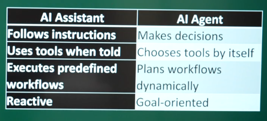

AI Assistant - Responds
AI Agent - Decides

Our Application has

1. Memory
2. Personality
3. Tools
4. File Reading
5. RAG
6. Decision Making (Still Missing) - AI Should decide which tool to call

`Problem Statement`

How many days are left until New year's Day

`Steps`

1. Find today's date
2. Find the date of New year's Day
3. Calculate the difference
4. Explain the result

Here the Agent decides and combine tools required to reach the goal.

Similar to how human solve a problem.

The AI Agent will receive

- The user request
- A list of tools along with instructions what each tool does.

It's first job is not to answer the user

It's first job is

- Decide which tools should it use `Planning`
- Execute the tools to generat the result. `Execution`

So the separation between `planning` and `Execution` is one of the defining chracteristics of modern AI agents

Many Frameworks make this process look magical.But the logic is straightforward.

```
User Goal (Question)
|
V
Plan (Planner decides which tool to choose)
|
v
Choose Tools
|
V
Execute Tools
|
V
Generate Result
|
V
Respond
```

A toolbox does not become useful because you have many tools, it becomes useful when you know

- which tool to use
- when to use and
- in which order.

The same is true for AI Agent.

Agentic AI is fundamentally about

- Decision Making, and
- Workflow Orchestration

  Not just adding more tools and powerful language models

## Building the Agent Brain

The Agent brain job is `planning` (how to solver the problem)

The brain does not solve the problem, it decide how to solver the problem

- Should I call a specific Tool,MCP
- Should I send the question to language model

```
User Question
|
V
Planner (Deciding which tool to be used)
|
V
Tool Name
|
V
Python
|
V
Execute Tool
|
V
Result
|
V
Language Model
|
V
Final Result
```

`Is the Planner also an LLM `

- Yes

So you go to LLM twice, first for asking the tool and second to give answer in a natural way.

`Planner` Decides what to do

`Assistant` Explain the result to the user (Behaviour)

- Different Prompts
- Different Responsibilities
- Same Underlying Model

This demonstrate one of the strengths of LLM, the LLM Model can perform multiple roles depending on the instructions it receives.

## Building our first Planning Agent

AIPlanner.py

```
from openai import OpenAI
from dotenv import load_dotenv
import os

load_dotenv()

def choose_tool(question):
    planner_prompt= f"""
                    You are an AI planner.
                    You return the tool to use based on the question.

                    Available tools
                    1. get_current_time
                        Use when the user ask for the current date and time
                    2. generate_password
                        Use when the user ask for a secure password
                    If no tool is requried, return
                    none

                    Return only the tool name
                    """

    client = OpenAI(
        base_url=os.getenv("BASE_URL"),
        api_key=os.getenv("API_KEY")
    )


    messages = [{
        "role": "system",
        "content": (
            planner_prompt
        )
    }]


    messages.append({
            "role":"user",
            "content":question
        })

    response = client.chat.completions.create(
        model=os.getenv("MODEL"),
        messages=messages
    )

    return response.choices[0].message.content

```

```
print(choose_tool("What is the current time"))
```

Output

```
get_current_time
```

## Let the AI Speak naturally

```
get_current_time
```

returns

```
02-08-2026 H:4522 AM
```

We could simply print it

But that feels robotic

Instead, lets ask the assistant to presend it naturally

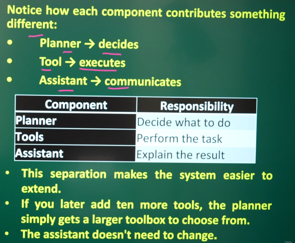

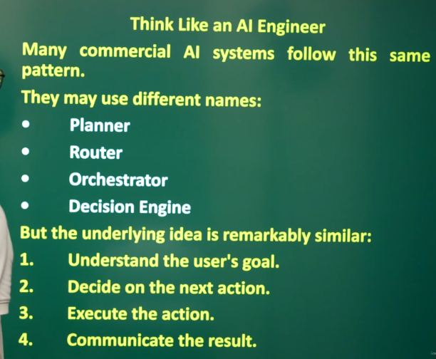

`Problem Statement`

Our planner can choose one tool, what if the user question require multiple tools

- Generate a password and save it in the file
- Read the meeting notes, summarize them, and send an email

Those tasks require several actions performed in sequence.

`Solution`

Multi-Step Planner

`Multi-Step Planner` plans a sequence of actions and behave much like humans solving complex problems.

## MCP (Model Context Protocol)

To use `external capabilities` in our AI Agent.

- Email Tool
- Calander Tool
- Stock Market Tool
- Weather Tool

Think of MCP (Model Context Protocol) as a `Open standard` that allow our AI Agent or Applicatoin to discover and use `external capabilities` in a consistent way.

External capabilities like

- Tools
- APIs
- Databases
- Documents
- Knowledge Sources

So our Agent will be able to

1. Discover available tools
2. Understand what each tool does
3. Choose an appropriate tool
4. Call the tool through a standard interface
5. receive the results.

So tool will be on the remote MCP Server, not in the Agent application.

## Understand MCP Architecture

Every MCP System has 3 major components

```
AI Agent
|
V
MCP Client
|
V
MCP Server
|
V
Tools
```

1. AI Agent : It has
   - Assistant
   - Planner
   - Memory
   - RAG
   - Tools Selection

   The Agent never call external tools directly, instead it talks to `MCP Client`.

2. MCP Client : Its Job is to call MCP Server to
   1. Discover available tools and ask for tool description
   2. Send Tool request and Receive tool result

   The Client knows how to speak to the MCP Server

   The Agent does not need to worry about protocol details.

3. MCP Server : It owns the tools
   - Weather tool
   - Calander Tool

   The first question MCP Client asks to MCP Server is

   `What tools do you have?`

   The MCP Server replies with a `List`

   Whenever MCP Client calls a Tool, MCP Server runs it and return the result.

So our Agent does not know how a specific tool works, just know there is a specific tool (calculator) available.

Just like using Web API

```
User Question
|
V
AI Agent
|
V
Planner
|
V
Weather Tool is needed
|
V
MCP Client
|
V
Call Weather Tool
|
V
MCP Server
|
V
Execute Weather Tools
|
V
Result
|
V
MCP Client
|
V
AI Agent
|
V
User
```

So user does not see MCP Client/Server, It only sees final result.

You can have multiple MCP Servers in an Agent

- Weather MCP Server
- Calander MCP Server
- Stock Market MCP Server

Each Server is specialized in a specific domain.

Suppose someone develops a new MCP Server for

- Stock Market
- Youtube
- Gmail
- AWS
- Docker

`Do you need to rewrite your Agent?`

No

You simply connect another MCP Server to your AI Agent and instantly gains the new abilities.

This is one of the biggest advantages of standardization.

## Build your first MCP Server

1. Install MCP SDK

   ```
   pip install fastmcp

   pip show fastmcp
   ```

2. Create `data_mcp_server/server.py`

   ```
    from datetime import datetime
    from fastmcp import FastMCP

    mcpserver = FastMCP("Time Server")


    @mcpserver.tool()
    def current_time():
        """Return the current date and time."""
        return datetime.now().strftime("%d-%m-%Y %H:%M:%S %p")

    if __name__ == "__main__":
        mcpserver.run()
   ```

   - @mcpserver.tool() decorator tell the server: This function is available in MCP clients
   - """Return the current date and time.""" is Tool description (DocString)
   - The MCP Framework can expose it to AI Agents.
   - The Planner can read it and decide: This tools look like correct tool.
   - So clear description is very important

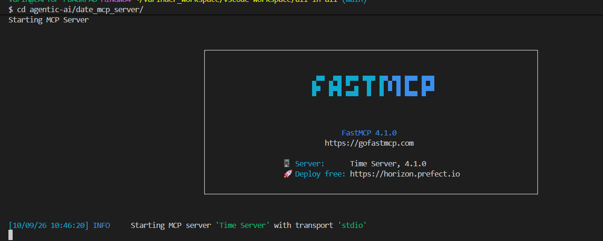

## Build MCP Client

The responsibilities of MCP Client are

- Connect to the MCP Server
- Discover available tools
- Execute a selected tool
- Return the results to the AI Agent

1. Create `data_mcp_client/client.py`

```
from fastmcp import Client

async def connect():
    """
    Connect to the MCP Server.
    """
    client = Client("../date_mcp_server/server.py")
    await client.__aenter__()
    print("Connected to the MCP Server..")
    return client

async def disconnect(client):
    """
    Close the the MCP Server.
    """
    await client.__exist__(None,None,None)


async def discover_tools(client):
    """
    Retrieve all tools from the server.
    """
    tools = await client.list_tools()
    return tools

async def execute_tool(client,tool_name,arguments=None):
    """
    Execute a tool.
    """
    if arguments is None:
        arguments = {}
    result = await client.call_tool(
        tool_name,arguments
    )
    return result
```

- you have to expicitly call disconnect(), to stop server processes and release all resources.

`Should the Planner know which server owns which tool`

No

`Should the client connect to every server separately`

Yes

`With Planner there is no hardcoded for chosing and executing the tool`

So AI Agent

- Discover external capabilities
- Understand tool descriptions
- Select the correct tool
- Execute the tool
- Present the result naturally

`Our AI Agent Perform 6 Steps`

1. Connect to MCP Server
2. Discover all available tools
3. Call Planner :
   - Pass it : User Input , Tools List
   - Planner creates tools_description
   - return the best fit tool based on question using `LLM`
4. Execute the best fit tool
5. Pass Result to `LLM` to generate natural response.

`Problem Statement`

What if we need to use two tools to respond to our questions.

`Fix`

Autonomous AI Agent , that use multiple tools (via `multi-stage planner`)

## Autonomous AI Agent

Autonomous AI Agent , that use multiple tools (via `multi-stage planner`)

After everystep you look at the result, and decide `what to do next`.
It should continue until the task is completed.

This process of repeatedly thinking, acting, and observing is exactly how humans solve complex problems

AI Agent should work the same way.

```
Think
|
V
Act
|
V
Observe
|
V
Think
|
V
Act
|
V
Observe
```

Called `Agent Loop`

## What is Agent Loop

An Agent loop is a repetitive cycle in which the AI Agent:

1. Think about the current situation
2. Decide the next action
3. Execute the action
4. Observe the result
5. Decides whether another action is required.

The loop continue until the goal has been achieved.

## Design the Agent Loop

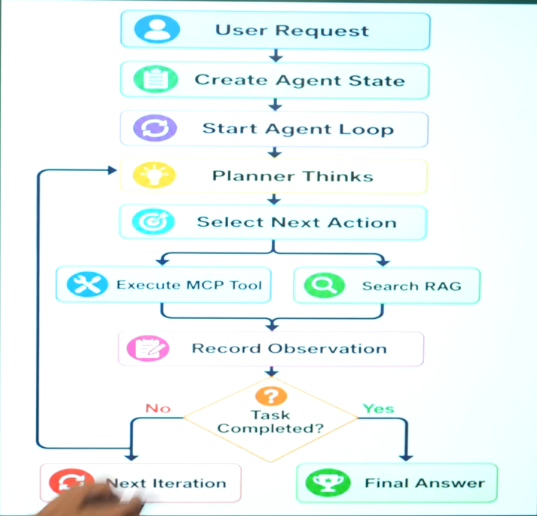

### Agent State :

When the planner run for the second time, how does it will know what happened in the first interation, so it needs some form of working memory, That is called Agent State.

`Question` : provide me a secure password and current time

The state initially contains:

- Current Step: 0
- Actions: None
- Observations: None
- Finished: False

### Action Loop

Loop over

- Think (Planner)
- Act Action (AI Agent)
- Observer Result (AI Agent)

The Planner receives 3 pieces of information

- Question
- Previous Action
- Previous Observation

Based on that the planner decides the next action.

The AI Agent stores the result

`Action State`

- Current Step: 1
- Actions: generate_password
- Observations: K#8Lm@4Pq
- Finished: False

`Action State`

- Current Step: 2
- Actions: current_time
- Observations: 09/10/2026 10:12:21 PM
- Finished: False

`Action State`

- Current Step: 3
- Actions: current_time
- Observations: 09/10/2026 10:12:21 PM
- Finished: True

Finally all the observations are combined into a user friendly response.

## Building the Agent State

`Agent State`

A dictionary containing everything the agent needs while solving the current task.

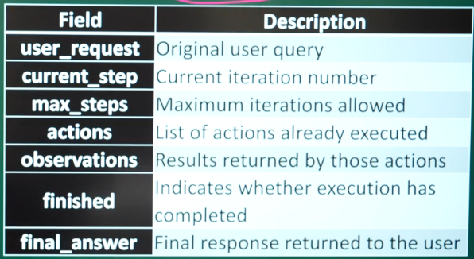

Max_steps : `To avoid infinite Loops`

Once the request has been completed, the state is discarded and a new state is created for the next request.

## Implementing the Agent State.

`state.py`

```
def create_state(user_request,max_steps=5):
    return{
        "user_request": user_request,
        "current_step":0,
        "max_steps":max_steps,
        "actions":[],
        "observations":[],
        "finished":False,
        "final_answer":""
    }
```

This function is called, on every new request arrive.

```
def add_action(state,action):
    state["action"].append(action)
```

After selecting the generate password tool by the planner

```
"actions": [
    "generate_password"
]
```

Keeping track of the previous actions, helps the planner avoid repeating the same task.

```
def add_observation(state,action,observation):
    state["observations"].append(
        {
            "steps":state["current_step"],
            "action":action,
            "observation":observation
        }
    )
```

This makes debugging much easier and provide valuable context for the planner

At the end of every iteration, we increate the step count

```
def next_step(state):
    state["current_step"] =  state["current_step"] + 1
```

This function determines whether the Agent Loop should continue.

Execution stops when either

- The Task has been completed
- The maximum number of iterations has been reached. This prevents the accidental infinite loops

```
def can_continue(state):
    return(
        not state["finished"]
        and
        state["current_steps"] < state["max_steps"]
    )
```

The function mark the task as completed

```
def finish(state,answer):
    state["finished"]=True
    state["final_answer"]=answer
```

## Building the Agent Loop

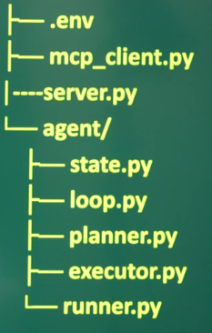

To avoid program running forever, our state contains max_steps

- It checks: can_continue(state) : The loop stops either the agent finishes the task or the max. number of steps has reached. `Very Important Safety mechanism for autonomous system.`

- We did not use LangGraph, CrewAI, AutoGen. We built the fundamental agent architecture using Python, LLM, MCP Architecture.

## From Next Action to Task Decomposition

`Task Decomposition`

So we Bread Big Task(`Goal`) into multiple sub-tasks

This is one of very important idea in `Agent Engineering`

## Building LLM bases Task Decomposer

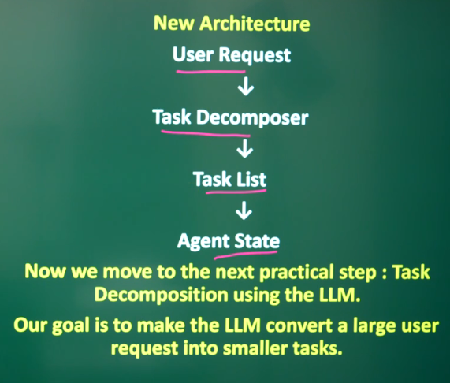

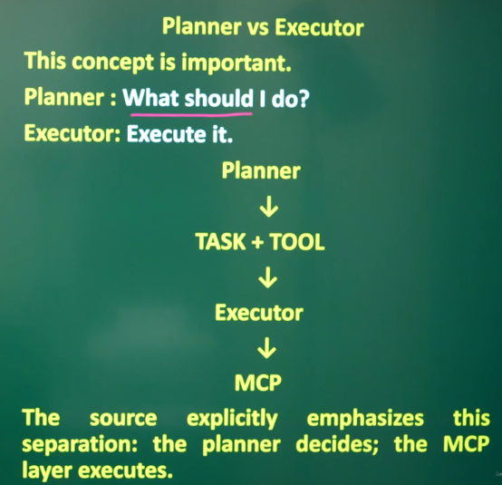

```

def decompose_task(user_request):
    prompt = f"""
            You are an AI task Planner.
            Break the user's request into smaller tasks
            Instructions:
            1. Create only the task necessary to complete the request.
            2. Put the task in the correct execution order.
            3. Each task should be a short action.
            4. Return only task per line
            5. Do not number the tasks
            6. Do not explain anything.
            User Request
            {user_request}
            """

    client = OpenAI(
        base_url=os.getenv("BASE_URL"),
        api_key=os.getenv("API_KEY")
    )

    response = client.chat.completions.create(
        model=os.getenv("MODEL"),
        messages=[
            {
                "role":"system",
                "content":"You are an AI Task Planner."
            },
            {
                "role":"user",
                "content":prompt
            }
        ]
    )

    result = response.choices[0].message.content.strip()

    tasks = []

    for line in result.splitlines():
        line = line.strip()
        if line:
            tasks.append(line)

    return tasks

```

## Adding tasks to Agent State

```

def add_task(state,task):
    state["task"].append({
        "task":task,
        "state":"pending"
    })

def complete_task(state,task):
    for item in state["tasks"]:
        if item["task"] == task:
            item["task"] = "completed"
        return

def add_result(state,result):
    state["results"].append(result)

def get_pending_tasks(state):

    return [
    item["task"]
    for item in state["tasks"]
    if item["status"] == "pending"
    ]

def all_tasks_completed(state):
    return all(
        item["status"] == "completed"
        for item in state["tasks"]
    )
```

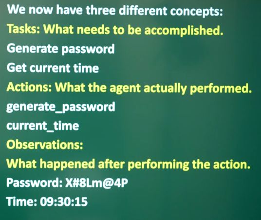

## State-Aware-Planner (Advanced Agent Planning)

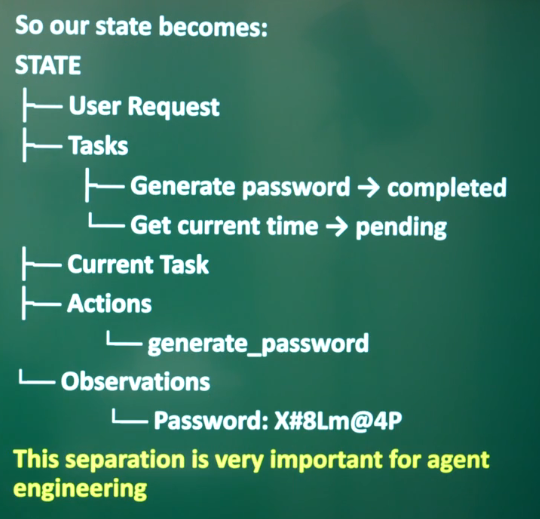

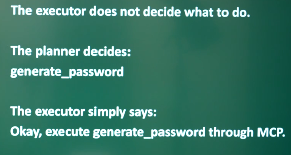

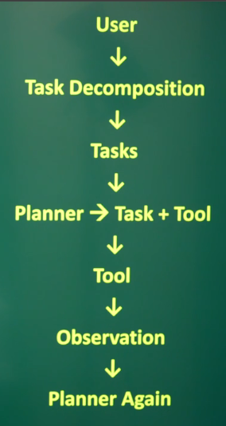

So our Agent :

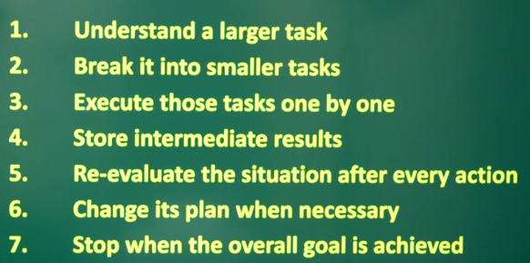

```
User Request
|
V
Decompose Goal
|
V
Create Task
|
V
Maintain State
|
V
Plan
|
V
Execute
|
V
Observe
|
V
Update
|
V
Plan Again
|
V
.
.
.
|
V
Finish
```

This is called `Dynamic Planning`

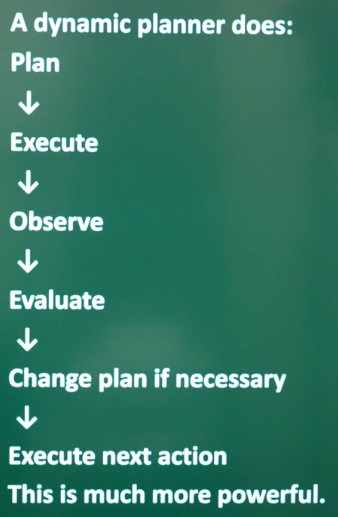

- An autonomous agent must have a stopping condition, to avoid it running forever.
- The decomposer breaks a large request into smaller tasks
- The tasks are stored inside the agent state
- The planner look at the tasks , previous actions and observatios, and decides what should happen next.
- The planner does not execute the tool, just decide what to do
- The executor and MCP layer decide how to execute it.
- After executor, the result becomes an observation.
- The state is updated
  - action
  - observations
  - results
  - current step
- The planner run again.

This gives us a `goal-oriented autonomous loop`

- We also introduced `Dynamic replanning`: if something goes wrong, the agent should not blindly continue with the outdated plan, it should reconsider the situation and decide what to do next.

## Advanced RAG

## Chunking

- Breaking documents into small pieces or chunks, create the embedding for each, and retrieve only the relevent chunks

- We should not split the documents randonly.

  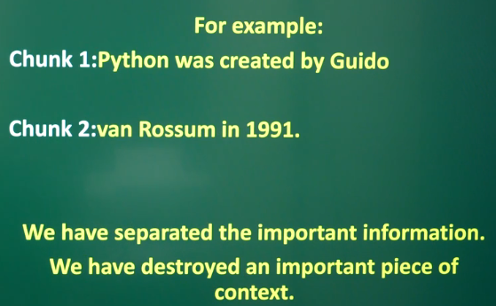

- Different chunking strategies
  - Fixed size chunking with overlap.
    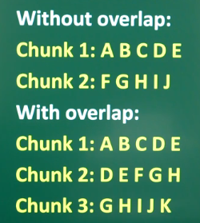

    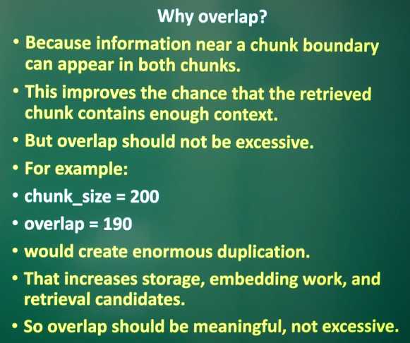

  - Paragraph based chunking
  - Heading based chunking

## Building a document chunking strategy with metadata

- Chunk Size : 200
- Overlap : 50

So

- Chunk1 :{0-200,"file1.txt",1}
- Chunk2 :{150-350,"file1.txt",2}
- Chunk3 :{250-450,"file1.txt",3}

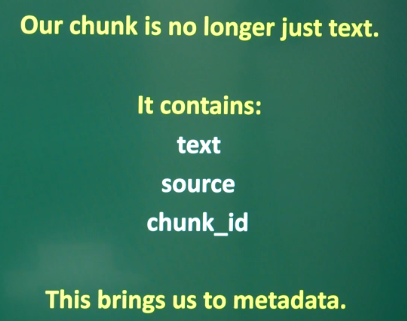

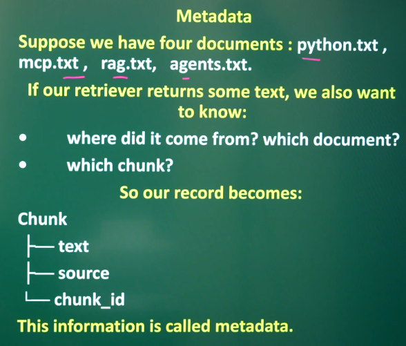

## Generating embeddings for Document chunks

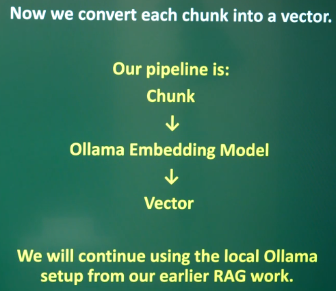

So we will do embedding of each chunk and store the vector in its chunk itself.

So the chunk will have

- Text
- Document Name
- Chunk_ID
- Embedding

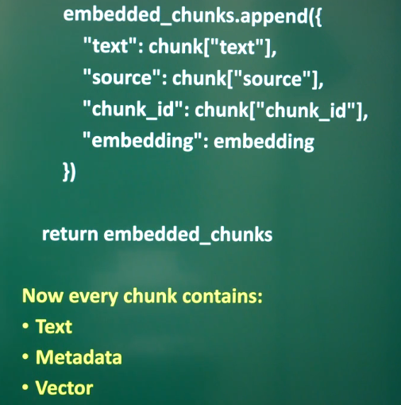

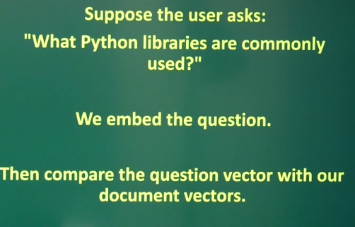

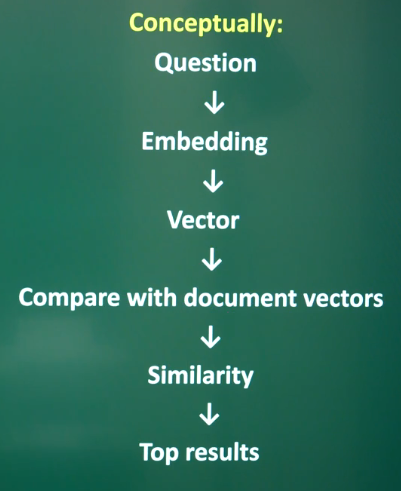

`NumPy`

- `cosine similarity` is directly related to `NumPy` in AI and RAG applications.
- `NumPy` helps you calculate how similar two vectors are mathematically.
- For more advanced text chunking, you might use `LangChain` or `LlamaIndex`

## Sementic Search

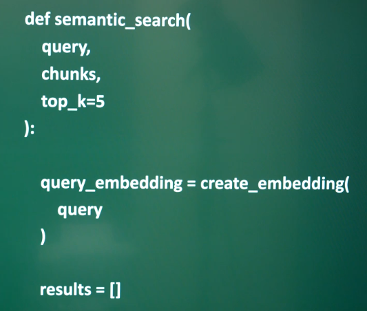

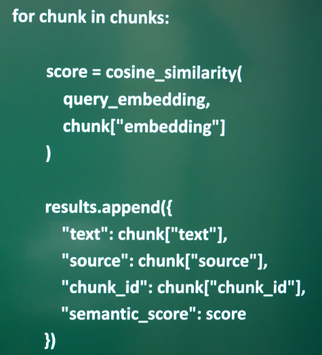

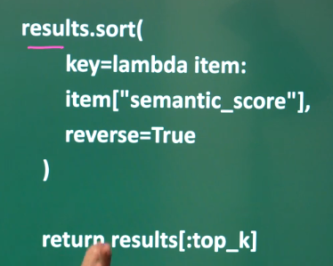

## What protocol allows AI applications to communicate with Tools

- Model Contex Protocol

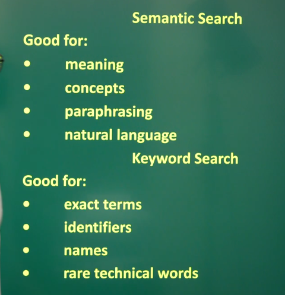

## Hybrid Search (Keyword Search + Sementic Search)

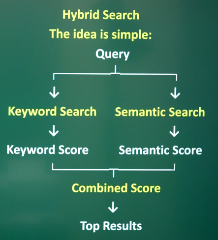

`Keyword Score`

```
Query : 50 words
Chunk Size: 200 words
Keyword matched: 10
Keyword Score = 10/50 = 0.2
```

`Sementic Score`

```
Score given by the cosine similarity between 0-1 both inclusive
```

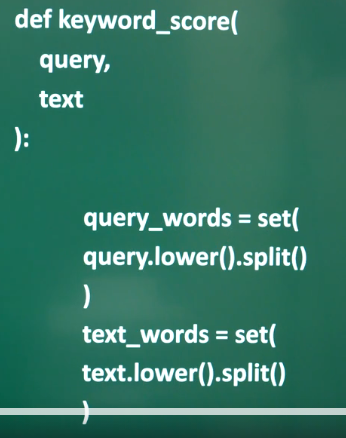

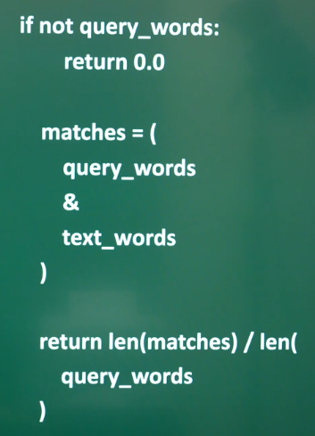

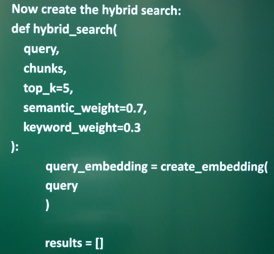

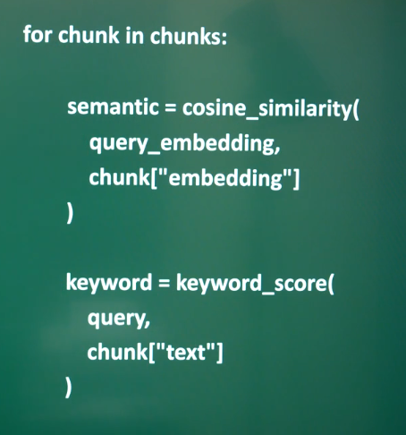

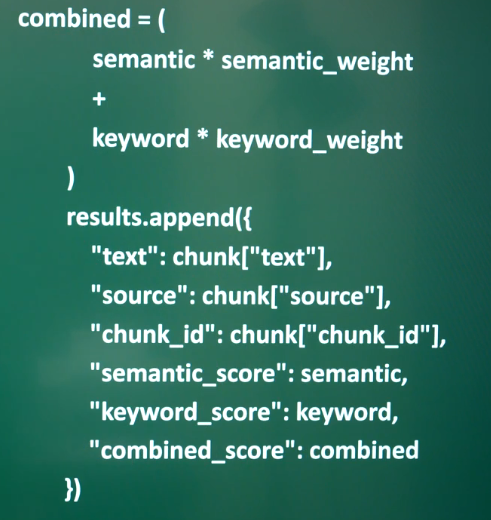

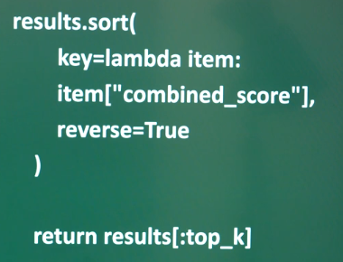

So we have

- sementic score
- keyword score
- combined score

So we can sort on the bases of any of these and get top_k chunks.

`Sementic_weight` and `Keyword_weight` in Hybrid Search

```
Final_Score = sementic_weight * sementic_search_score


Final_Score = Keyword_weight * keyword_search_score
```

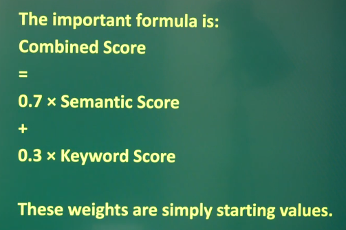

## Re-Ranking - Finding most relevant results

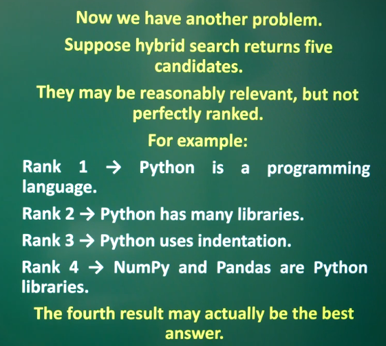

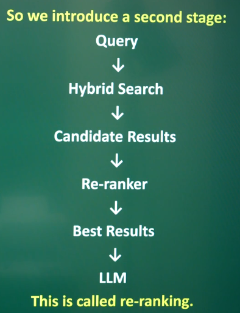

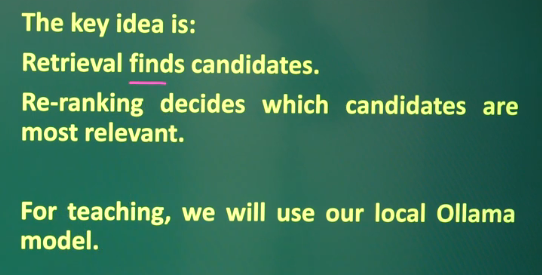

Language Model is doing

1. Planning
2. Task Decomposition
3. Giving the Answer Naturally
4. Re-Ranking

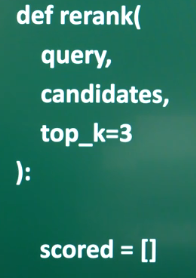

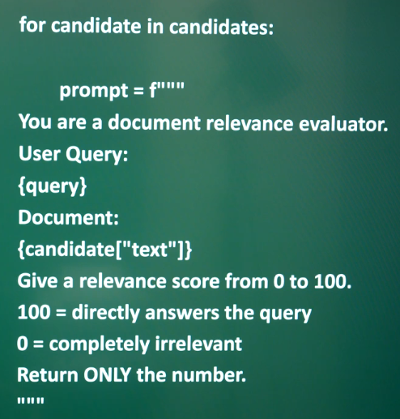

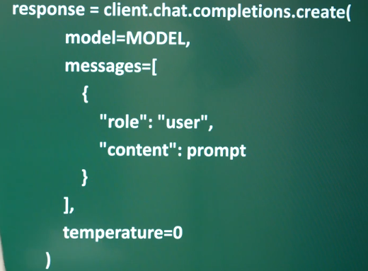

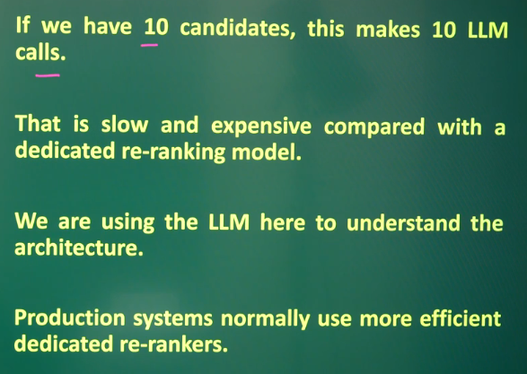

## Building a vector store with ChromaDB and FAISS

Other better Options:

- Qdrant (best self-hosted vector database to evaluate for production RAG)
- PostgreSQL + PgVector (best when you already use PostgreSQL)
- ChromaDB (Good for POC and local apps.)

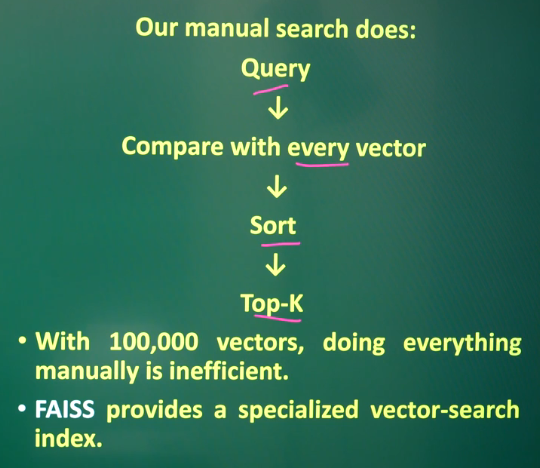

For a Python multi-agent orchestrator with RAG, I would shortlist these three:

- Qdrant — a dedicated vector database for a production application.
- pgvector — if your enterprise already uses PostgreSQL.
- FAISS or hnswlib — if you want to build and manage your own vector-search layer.

## LangGraph

It represents a workflow as a Graph.

There are 3 concepts you should remember

1. State : The information travelling through our workflow
2. Node : A piece of work performed by the workflow and update the state
3. Edge : The connection that determines what heppens next.

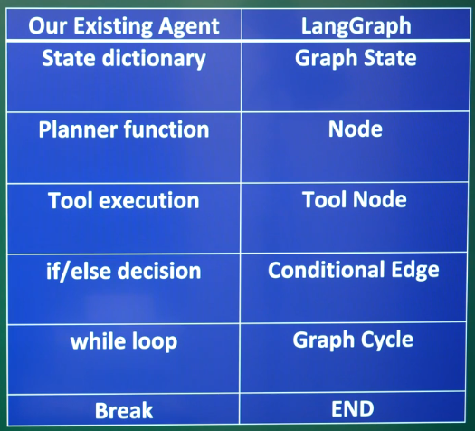

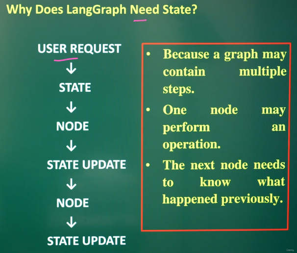

`State Schema`

## Install langgraph

```
pip install langgraph

pip show langgraph
```

`TypedDict` to describe the structure of the dictionary that travel through the graph.

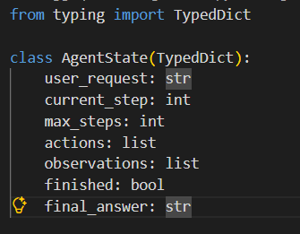

`Node` : A function that receives current state and return updated state, so Node take only state as input not other argument.

## Create Planner node

`StateGraph` :The is main LangGraph class used to create a graph based on a shared state.

`START` This represents the entry point of the LangGraph. The graph starts from the START and moves to the first node.

`END` This represents the termination point

```
START (Node)
|
V
PLANNER
|
V
END (Node)
```

So the workflow is converted into Graph in LangGraph.
