## OpenRouter

It is a browser-based platform that lets developers access many different AI models through one API.

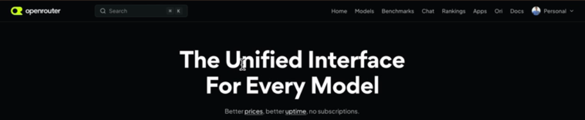

- Login and Create a Key

  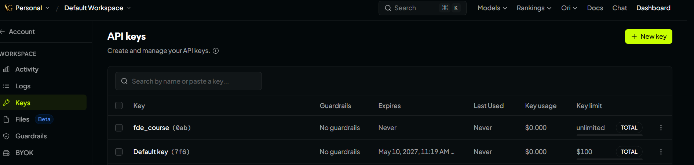

For example, you can access models from providers such as:

- OpenAI (GPT)
- Anthropic (Claude)
- Google (Gemini)
- Meta (Llama)
- DeepSeek

Instead of integrating separately with every AI provider, you can use OpenRouter as a common gateway.

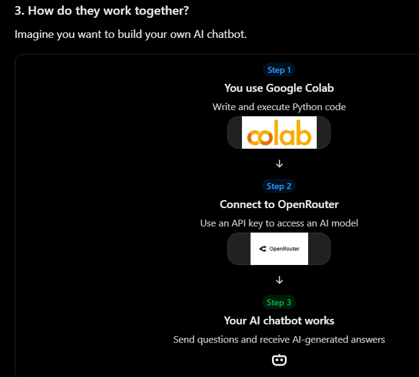

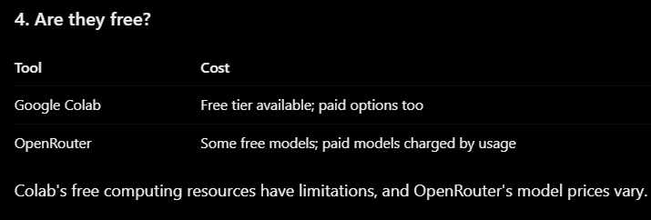

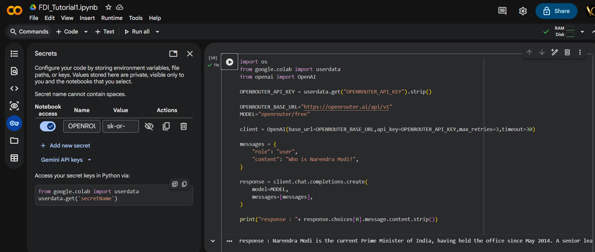

```
import os
from google.colab import userdata
from openai import OpenAI

OPENROUTER_API_KEY = userdata.get("OPENROUTER_API_KEY").strip()

OPENROUTER_BASE_URL="https://openrouter.ai/api/v1"
MODEL="openrouter/free"

client = OpenAI(base_url=OPENROUTER_BASE_URL,api_key=OPENROUTER_API_KEY,max_retries=3,timeout=30)

messages = {
    "role": "user",
    "content": "Who is Narendra Modi!",
}

response = client.chat.completions.create(
    model=MODEL,
    messages=[messages],
)


print("Answered by Model: ", response.model)

print("response : "+ response.choices[0].message.content.strip())

```

```
Answered by Model:  dots-studio/dots-3-note-preview:free
```

## Instant Gratification

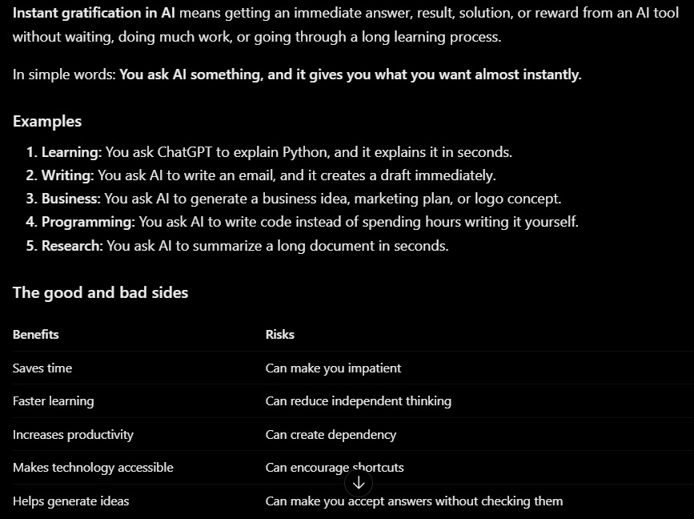

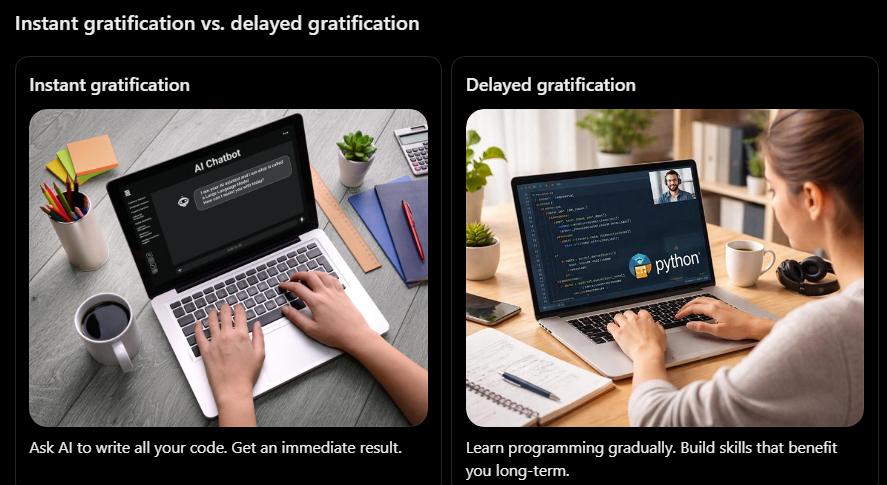

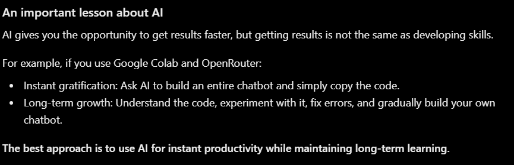

## Agent Harness

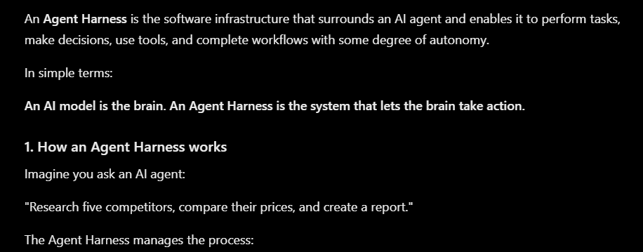

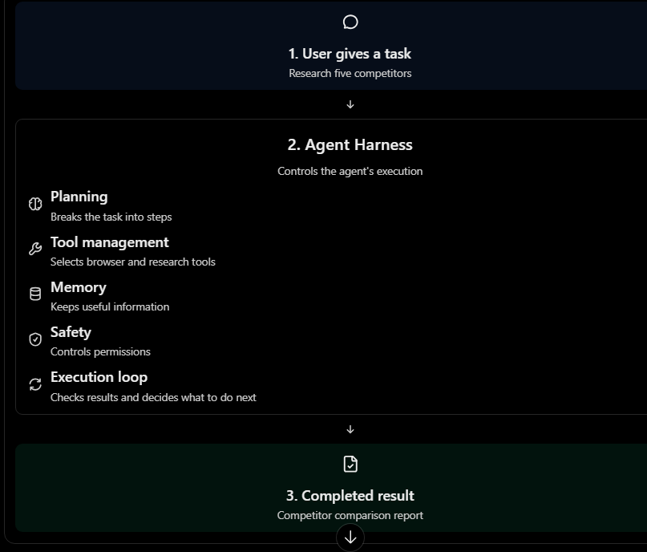

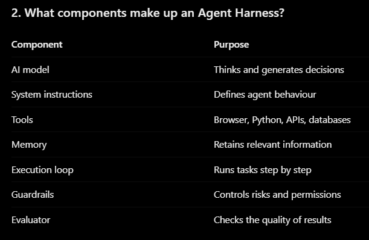

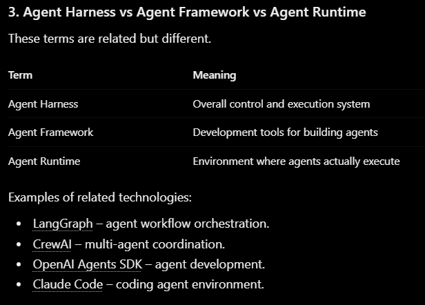

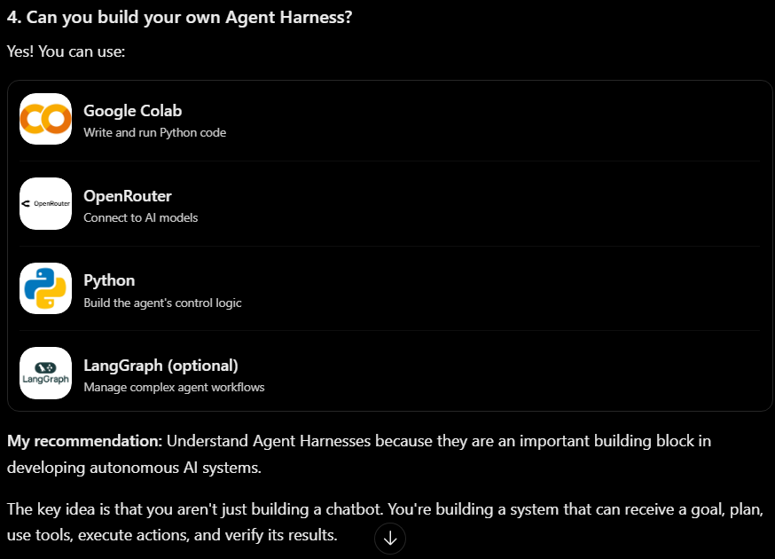

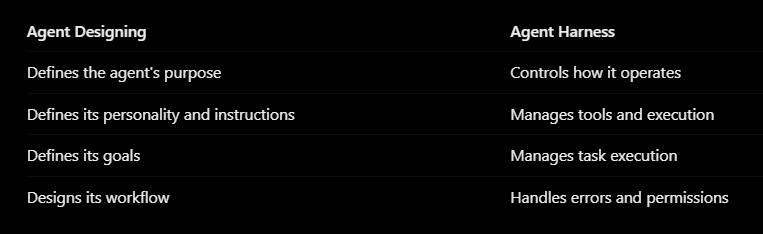

## 2. AAn LLM Solves a Maze : Tool Calling and an Agent Loop from Scratch

```
from bs4 import BeautifulSoup
import requests

@mcpserver.tool()
def read_web_page(url:str = MAZE_URL):
    """Read a web page in the maze and return the text on the page, without the HTML"""
    print(f"Reading web page:{url}")

    if not url.startswith(MAZE_URL):
        return f"Sorry, this tool can only read pages in the maze. Please ask for a URL that start with {MAZE_URL}"

    response = requests.get(url,timeout=20)
    page = BeautifulSoup(response.text, "html.parser")

    return page.body.get_text(separator="\n", strip=True)
```

## 3. Roadmap AI Engineer to AI Architect and AI FDE

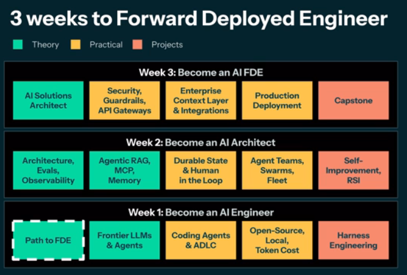

## 4. What is AI Forward Deployment Engineer = AI Solution Architect

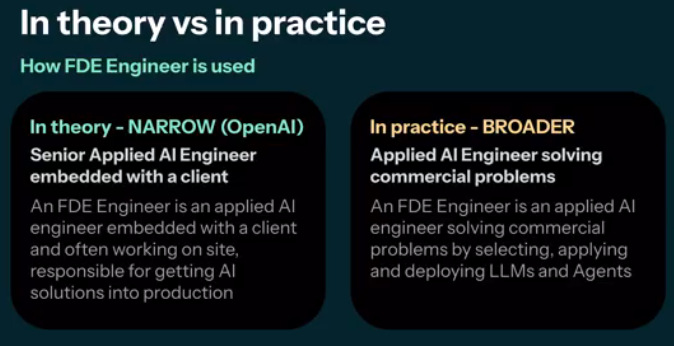

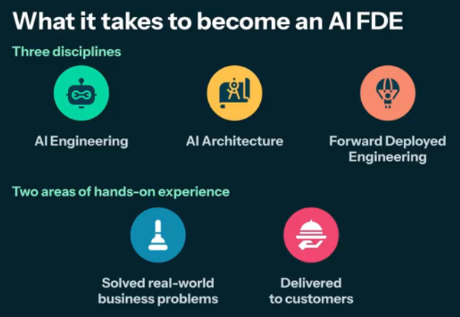

## 5. The Skills, Tools and Experience you need to become an AI FDE

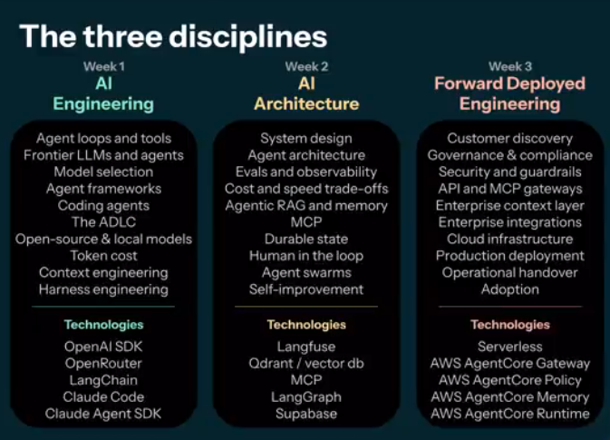

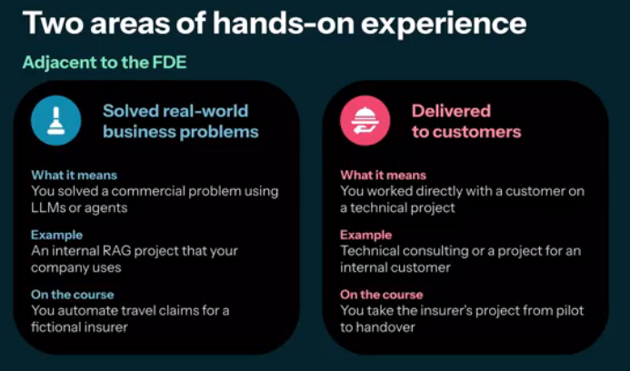

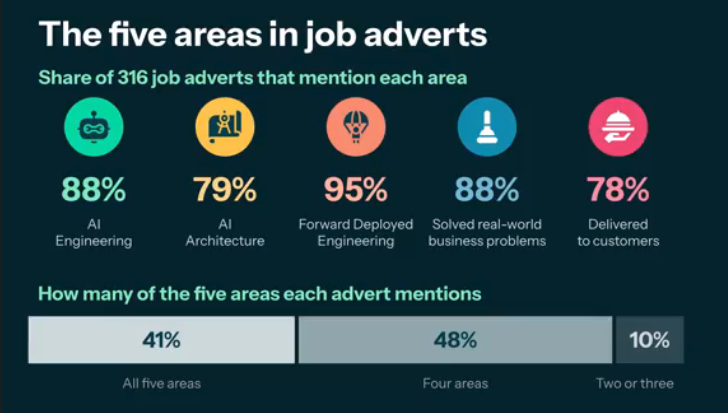

## 6. Environment Setup

- VSCode
- Git
- Node
- uv

uv is a fast Python package and project manager. It is an alternative to tools such as pip, venv,

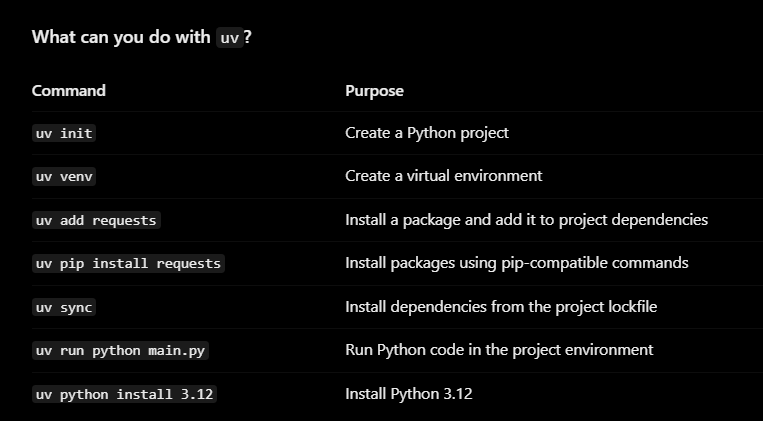

1. Install uv

```
winget install --id astral-sh.uv -e
```

2. Create a project

```
uv init multi-agent-app1
cd multi-agent-app1
```

3. Create a virtual environment

```
uv venv
```

4. Install your dependencies

```
uv add fastmcp openai python-dotenv requests beautifulsoup4
```

5. Run your application

```
uv run python runner.py
```

Why use uv?

- Much faster package installation than traditional pip in many situations.
- Manages Python versions.
- Creates and manages virtual environments.
- Tracks dependencies in pyproject.toml.
- Uses uv.lock to help reproduce the same dependency versions.

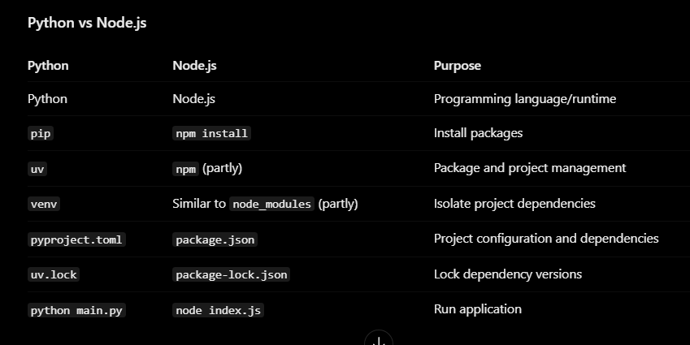

## 7. Clone the repo

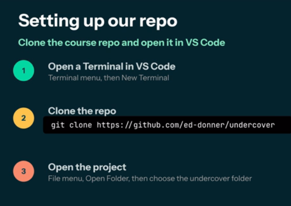

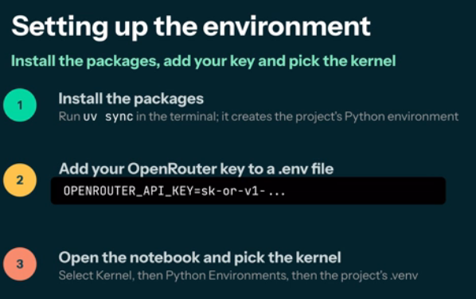

### Install Extension

- Python (From Microsoft)

  

- Jupyter (From Microsoft)

  

## 8. Tool to render the URL content
