## 1. Build your first Autonomous AI Agent with n8n (Low Code or No-Code Tool)

- n8n platform on web for AI Agentic development with low/no code
- Just need account onto it
- 14 days trial


## 2. Course Roadmap

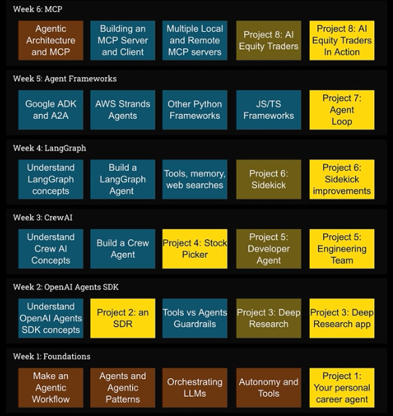


## 3. Path to become Proficient AI Engineer

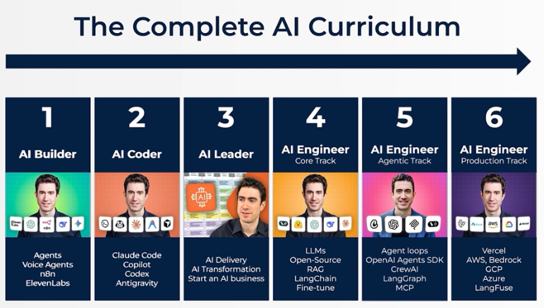


## 4. Environment Setup - UV, API Key, Costs , GitHub Repo

- UV is python project and package management tool, make environment setup very easy


AI Engineer wear two hats

- SOftware Engineer
- Data scientist

## 5. Windows Setup - VSCode, Run UV

- Install VS Code with extensions, not plugins
  - Python
  - Jupyter Notebook

- Run UV init to initialize a project

```
> uv --version

> uv init <project-name>

> uv venv

> uv add fastmcp

> uv sync

```

## 7. Setup OpenAI API Key and .env

Use Jupyter Notebooks (.ipynb) - The excecution order matters,

- Select Kerner in the .ipynb


## 9. What is AI Agent? Definition, Workflows vs Agents Explained


Example :

- Deep Research Workflow : Research-Review-Report
- GPT Agent : Openended in nature

## 10. AI Agentic Design Patterns - Chaining, Routing and Orchestrator

- 5 Design Patterns for workflows
- 1 Design Pattern for Agents

Help you design the solution, How to solve the problem


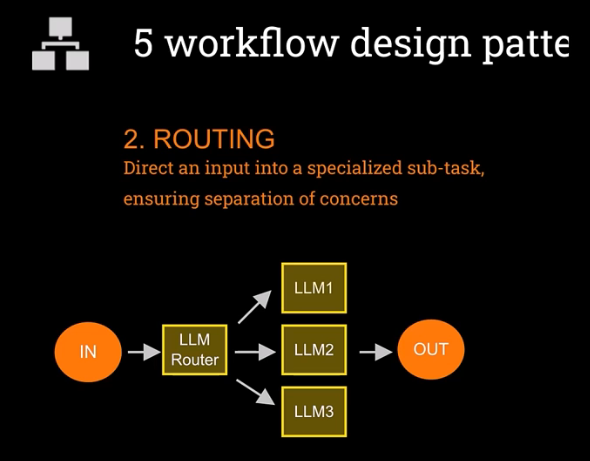

Eg: Customer Support system, where request route to different LLM based on the type of user request like finance query, HR query.

- Specialized LLMs for specific domain , using separation of concerns

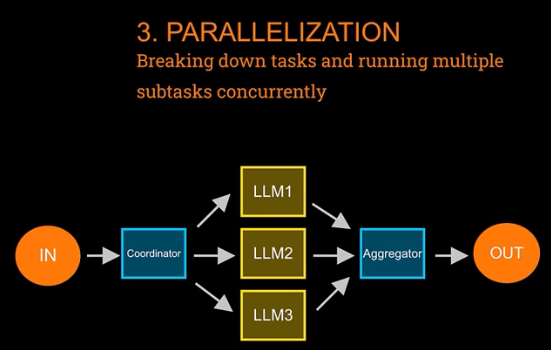

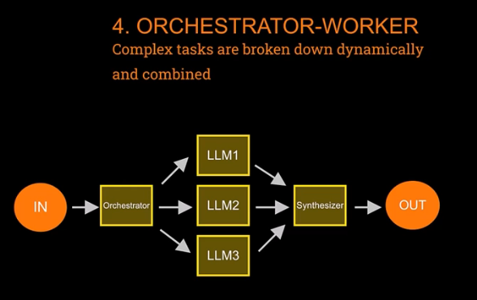

Here Orchestrator and Synthesizer both uses LLM

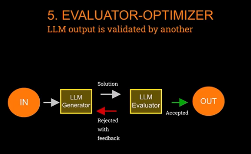

Also Called `LLM as a Judge`

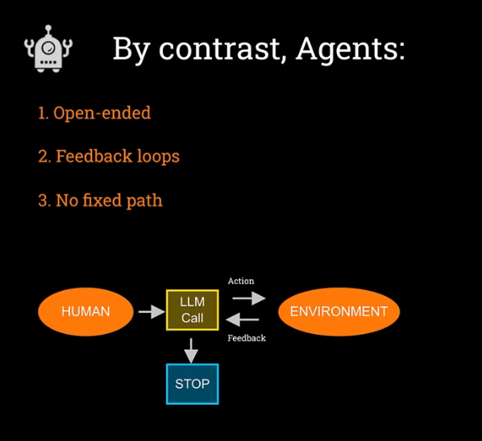

## 11. Agentic AI - Risks, Guardrails, Evals and Traps to Avoid


Risk Mitigations Techniques:

- Observability
- Evals : Using Evaluator-Optimizer design pattern(Also called - LLM as a Judge) can be used
- Guardrails :

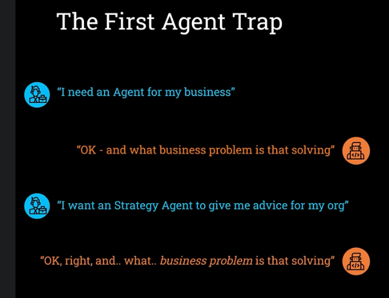

### Problem : LLMs are good at generating believable content

- `Focus on the Business Problem`, rather than providing the solution. Many can be solved without Agentic AI Solution

- LLMs are good at generating believable content, that might be incorrect. So to measure the success of our Agent, we have to run it against a metrix. So besides `Focus on the Business Problem`, we also have to understand how we will evaluate the `Success`

`LLM` are Models that generate plossable (Believable) tokens

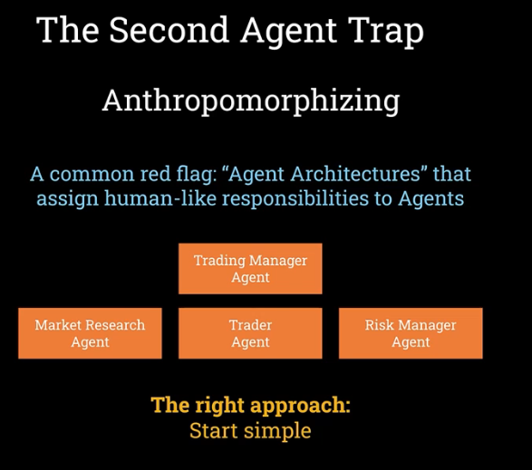

Start with

- 1 LLM
- 1 Agent
- 1 Goal

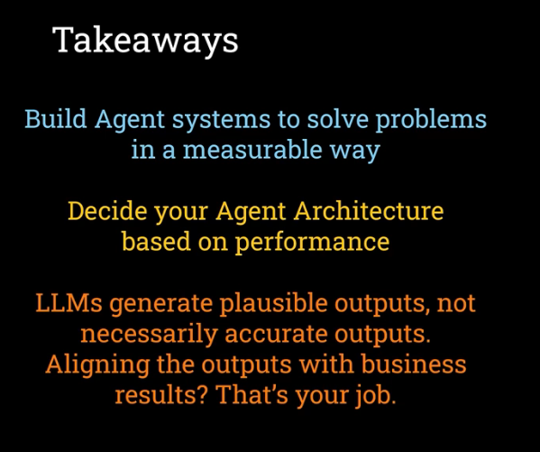

We are developing AI Agents, not using Agents (claude code), so can not complaint for hallusination, we have to code for it.

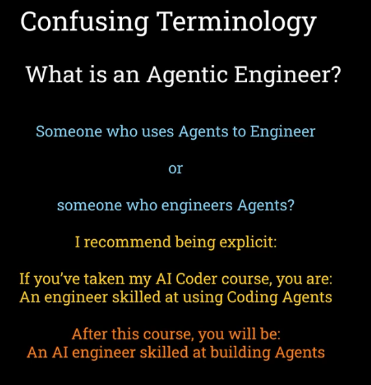

## 12. LLM Providers: OpenAI, Anthropic, Google, DeepSeekAI, Groq & Inferance Providers : Ollama, OpenRouter

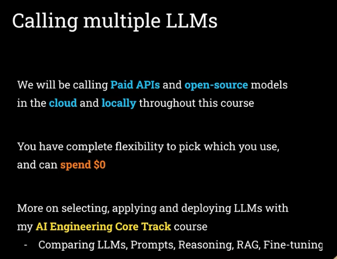

- Grok is a LLM by xAI

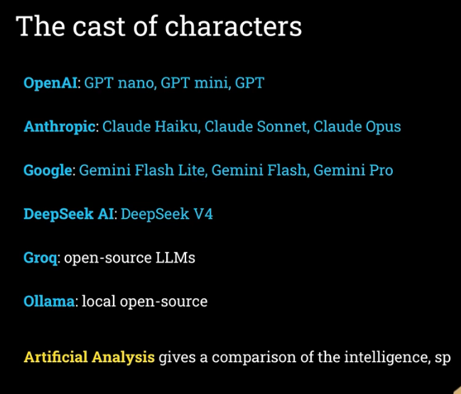

## 13. Setup multiple LLM API Keys and Generate a Question to Ask

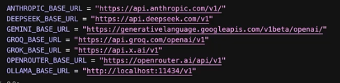

```
from openai import OpenAI
from dotenv import load_dotenv
import os

load_dotenv()

print(os.getenv("BASE_URL"))

client = OpenAI(
    base_url=os.getenv("BASE_URL"),
    api_key=os.getenv("API_KEY")
)

question="who is modi"

messages = [
    {
        "role": "user",
        "content": question
    }
]

response = client.chat.completions.create(
    model=os.getenv("MODEL"),
    messages=messages
)

print(response.choices[0].message.conent)
```

- All providers support OpenAI client

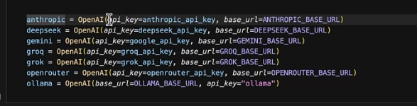

`reasoning_effort`


## 15. Install Ollama and run Local LLMs : Qwen, Llama, GPT-OSS, Gemma


- Qwen - From AliBaba


- models with `cloud` run on cloud

```
ollama ls
ollama pull <LLM>:<Version>
ollama run <LLM>:<Version>
ollama rm <LLM>:<Version>

```

## 16. LLM as a Judge, Rank Multiple LLMs with an Orchestration Flow

```
name = ["varinder", "rajinder"]
age = ["42", "35"]

for name, age in zip(name, age):
    print(f"Name: {name} | Age: {age}")
```

Name: varinder | Age: 42
Name: rajinder | Age: 35

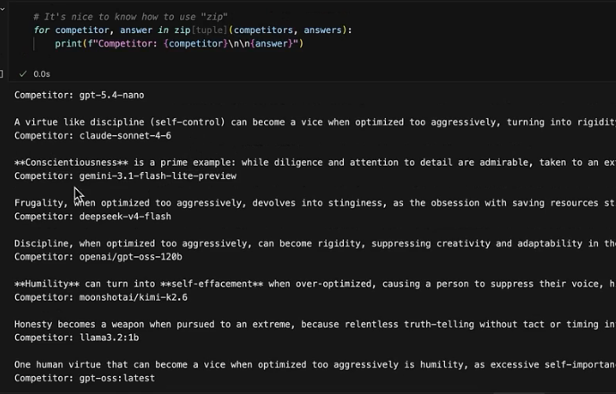

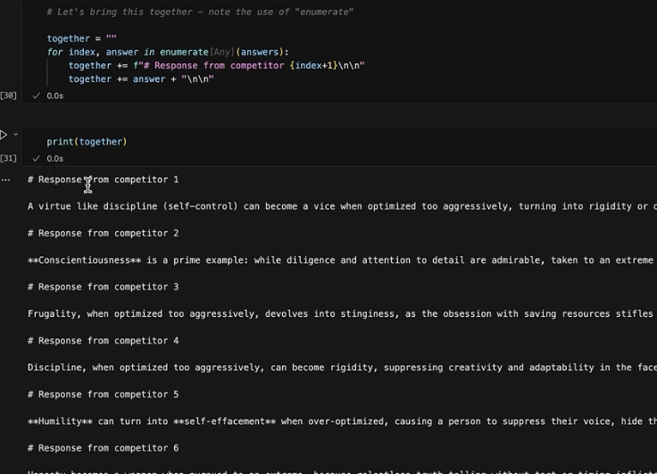


Ensure use different model for LLM as a Judge (Evaluator-Optimizer (EO) Design Pattern)


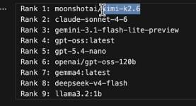

## 17. The Agent Landscape Frameworks, Runtimes, Tools and Builders

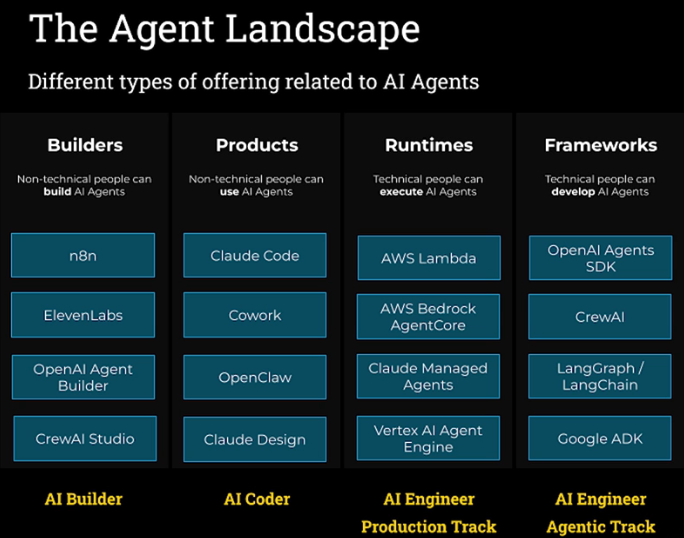


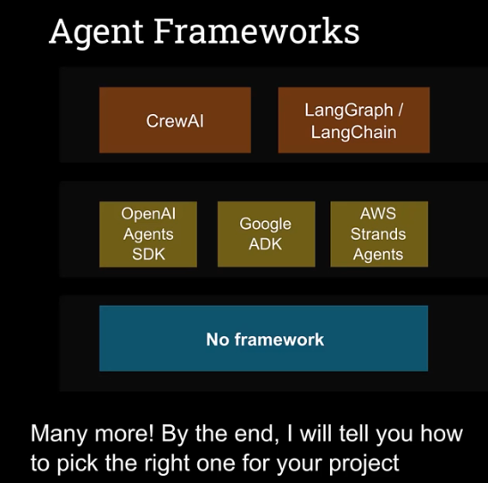

## 18. How Tool Calling Works : The Truth Behind AI Agent Autonomy

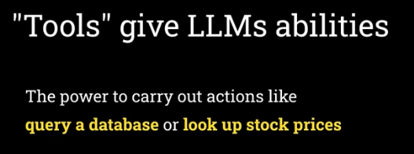


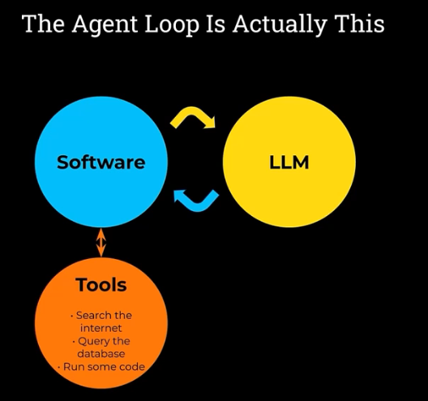

## 19. Start the Digital Twin : Read a PDF and Master System Prompts

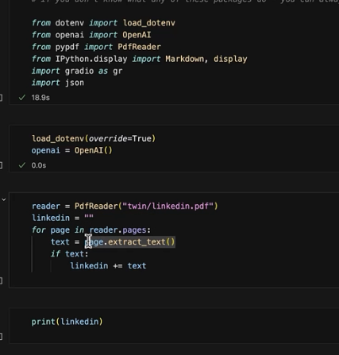


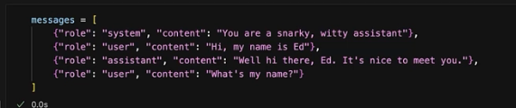

## 20. Build a Chat UI with Gradio and Define your First Agent Tool

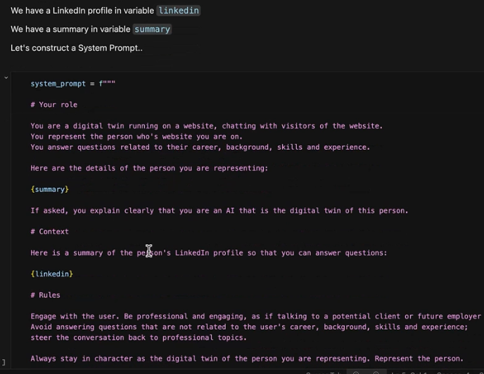

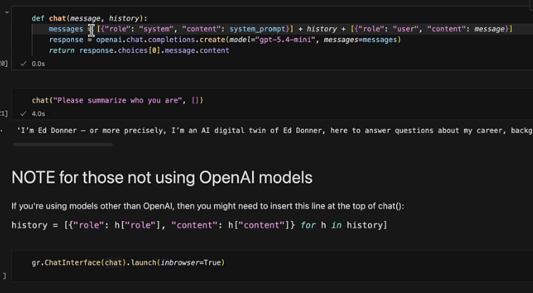

```

from openai import OpenAI
from dotenv import load_dotenv
import os
import gradio as gr

load_dotenv()

client = OpenAI(
    base_url=os.getenv("BASE_URL"),
    api_key=os.getenv("API_KEY")
)


def chat(message, history):
    messages = [
        {
            "role": "system",
            "content": "You are an AI Agent"
        }
    ]

    # Add previous conversation history
    for item in history:
        if isinstance(item, dict):
            messages.append({
                "role": item["role"],
                "content": item["content"]
            })
        else:
            # Older Gradio history format: (user, assistant)
            user_message, assistant_message = item
            messages.append({"role": "user", "content": user_message})
            if assistant_message:
                messages.append({"role": "assistant", "content": assistant_message})

    # Add current user message
    messages.append({
        "role": "user",
        "content": message
    })

    response = client.chat.completions.create(
        model=os.getenv("MODEL"),
        messages=messages
    )

    return response.choices[0].message.content


demo = gr.ChatInterface(
    fn=chat,
    title="My Chatbot",
    description="Ask me anything!"
)

demo.launch(inbrowser=True, share=True)

```


