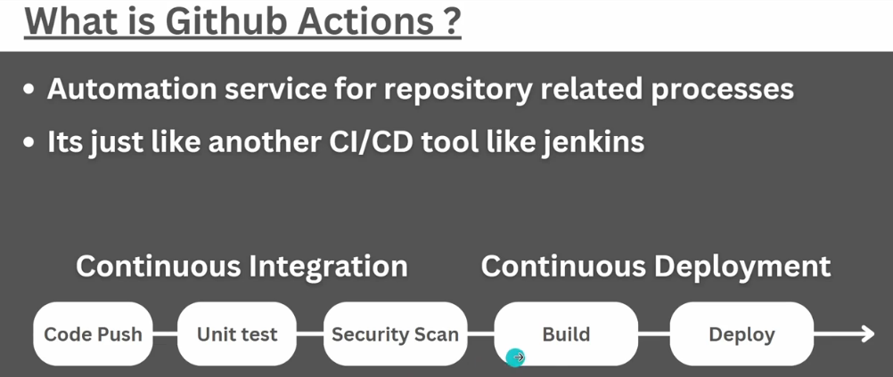
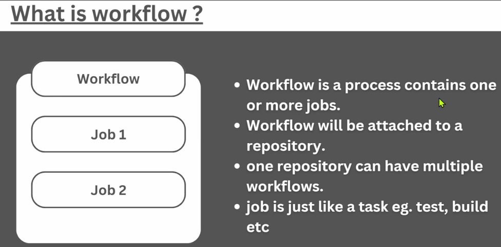
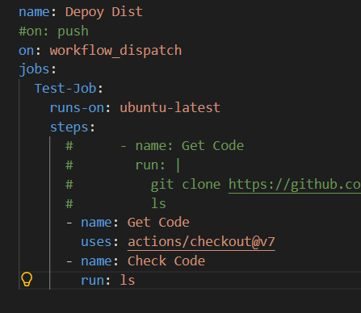
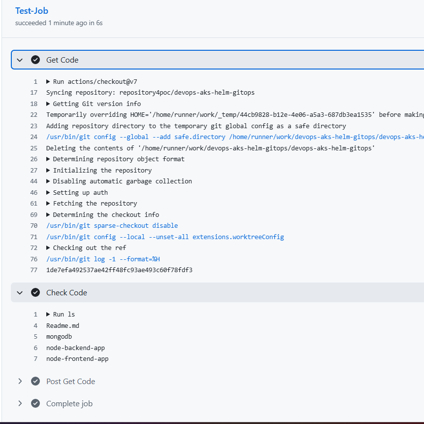
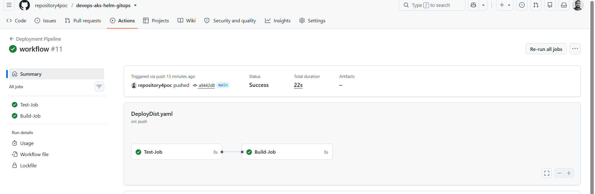
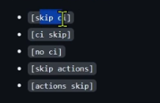
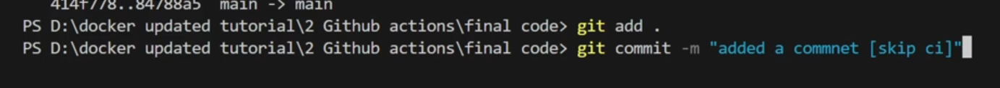

- Build : Compile the Code
- Unit Test : Test none of the unit functionality is breaking
- Security Scan : Code Quality Check - Comments, Test Coverage, Duplicate Code,
  '





- `Repository` > `Workflows` > `Jobs` > `Steps`

## Github Runners

https://docs.github.com/en/actions/reference/runners/github-hosted-runners#single-cpu-runners

## Github Marketplace

Provide pre-build actions for your workflow

https://github.com/marketplace?query=checkout






## Setup nodejs and run test cases

- Check is nodejs installed on GitHub runner node

  https://github.com/actions/runner-images/blob/main/images/ubuntu/Ubuntu2404-Readme.md

- execute
  - cd node-backend-app
  - `npm run test`

## Sequencital Flow

Use `needs` to put jobs in sequence, otherwise jobs will run in parallel

```
name: Deployment Pipeline
on: push
#on: workflow_dispatch
jobs:
  Test-Job:
    runs-on: ubuntu-latest
    steps:
      - name: Get Code
        uses: actions/checkout@v7
      - name: Check Codend-app
          npm test
  Build-Job:
    needs: [Test-Job]
    runs-on: ubuntu-latest
    steps:
```



## Skip workflow to trigger



Put anyof these in the commit comments will ignore the workflow trigger.

- on: push
- on: pull_request



## Cache dependencies for speed

```

- name: Install Node
  uses: actions/setup-node@v7
  with:
    node-version: 24
    cache: npm
    cache-dependency-path: node-backend-app/package-lock.json
```

## Filters

```
on:
  workflow_dispatch:
  push:
    branches:
      - main
      - 'features/**'
    paths-ignore:
      - Readme.md
```

## Custom Composite Action - reusing duplicate steps

## SonarQube

```
name: Build
on:
  push:
    branches:
      - main
  pull_request:
    types: [opened, synchronize, reopened]
jobs:
  sonarqube:
    name: SonarQube
    runs-on: ubuntu-latest
    steps:
      - uses: actions/checkout@34e114876b0b11c390a56381ad16ebd13914f8d5 # v4.3.1
        with:
          fetch-depth: 0 # Shallow clones should be disabled for a better relevancy of analysis
      - name: Cache SonarQube packages
        uses: actions/cache@0057852bfaa89a56745cba8c7296529d2fc39830 # v4.3.0
        with:
          path: ~/.sonar/cache
          key: ${{ runner.os }}-sonar
          restore-keys: ${{ runner.os }}-sonar
      - name: SonarQube Scan
        uses: SonarSource/sonarqube-scan-action@d209202bc7d53ff1cc128f7f907dac145c9d6ae9 # v8.3.0
        env:
          SONAR_TOKEN: ${{ secrets.SONAR_TOKEN }}

```
